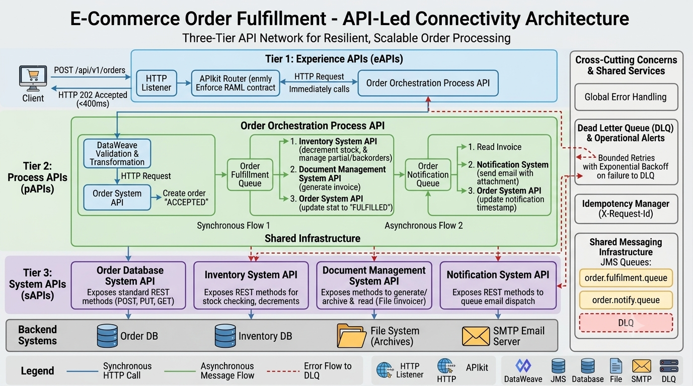
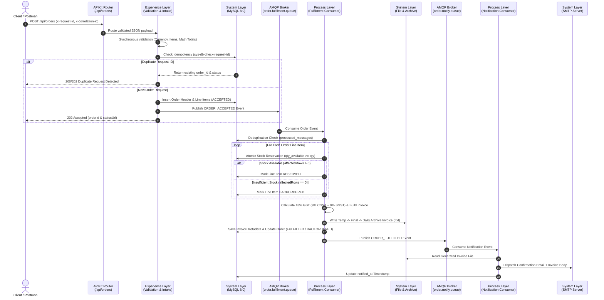

<div align="center">

# 🛒 E-Commerce Order Fulfillment Pipeline
### **Cognizant MuleSoft Hackathon — Use Case 16**
*An Enterprise-Grade, Event-Driven, Three-Tier API-Led Integration Pipeline built on Mule 4.9 & Java 17*

[](https://www.mulesoft.com/)
[](https://adoptium.net/)
[](https://docs.mulesoft.com/dataweave/latest/)
[](https://docs.mulesoft.com/apikit/)
[](https://www.rabbitmq.com/)
[](https://www.mysql.com/)
[](#%EF%B8%8F-munit-test-suite--code-coverage)

---

[📐 Architecture](#-system-architecture) •
[✨ Key Capabilities](#-enterprise-capabilities) •
[📂 Repository Structure](#-repository-artifacts--structure) •
[🔌 API Contract](#-api-specification--endpoints) •
[🧪 MUnit Suite](#%EF%B8%8F-munit-test-suite--code-coverage) •
[🛠️ Challenges Solved](#%EF%B8%8F-engineering-challenges--resolutions) •
[🚀 Quick Start](#-deployment--quick-start)

</div>

---

## 📖 Executive Summary

The **E-Commerce Order Fulfillment Pipeline** is a fault-tolerant, asynchronous order processing engine designed around MuleSoft's **Three-Tier API-Led Connectivity** paradigm (**Experience**, **Process**, and **System** layers). 

It decouples high-throughput HTTP order intake from heavy downstream fulfillment workflows using **AMQP message brokers**, guarantees **idempotent request and message processing**, performs **atomic database inventory reservation**, generates **GST-compliant plaintext tax invoices**, and dispatches real-time **SMTP email notifications** with full end-to-end `x-correlation-id` traceability.

---

## 📐 System Architecture

### High-Level Architecture Blueprint
<div align="center">
  
</div>

### End-to-End Event-Driven Sequence Flow



---

## ✨ Enterprise Capabilities

| Capability | Architectural Implementation |
| :--- | :--- |
| **Three-Tier API-Led Modularity** | Clean separation across `e-commerce-order-fullfillment-pipeline.xml` (APIKit Router), `api-experience-layer.xml`, `api-process-layer.xml`, and `api-system-layer.xml`. |
| **Synchronous Payload Validation** | Inline DataWeave 2.0 validation verifying non-empty items, supported currencies (`INR`, `USD`, `EUR`), positive quantities, line-item math (`quantity * unitPrice == lineTotal`), and header totals. |
| **Dual-Layer Idempotency** | **HTTP Layer:** Checks `x-request-id` against the `orders` table to prevent duplicate order creation.<br/>**Queue Layer:** Checks `jms_message_id` against `processed_messages` to safely drop redelivered broker messages. |
| **Atomic Inventory & Backorders** | Conditional SQL updates reserve stock atomically without race conditions. Out-of-stock items automatically transition the order state to `BACKORDERED` without halting valid line items. |
| **Automated GST Tax Invoicing** | Generates formatted plaintext tax invoices (`INV-2026-XXXXXXX.txt`) with **18% GST** breakdowns (**9% CGST** + **9% SGST**), atomic `.tmp`-to-final writes, and dated archiving (`/archive/yyyy-MM-dd/`). |
| **Fault Tolerance & DLQ Routing** | Global Error Handler (`main-global-error-handler`) maps `DB:CONNECTIVITY` and `AMQP:CONNECTIVITY` to `503 Service Unavailable`, while queue consumers route poisoned messages to the Dead Letter Queue (`order.dlq`). |

---

## 📂 Repository Artifacts & Structure

```text
E-Commerce-order-fullfillment-/
├── 📁 project_/                                     # Complete Mule 4.9 Anypoint Studio / Maven Project
│   ├── 📁 src/main/mule/
│   │   ├── e-commerce-order-fullfillment-pipeline.xml  # Master APIKit Router & Console
│   │   ├── api-experience-layer.xml                    # POST Intake & GET Status Polling Flows
│   │   ├── api-process-layer.xml                       # Fulfilment & Notification AMQP Consumers
│   │   ├── api-system-layer.xml                        # DB, File, and SMTP System Subflows
│   │   ├── global-config.xml                           # Connector Configs & Secure Properties
│   │   └── global-error-handler.xml                    # Centralized 503/500 Exception Strategy
│   ├── 📁 src/main/resources/
│   │   └── 📁 api/
│   │       └── e-commerce-order-fullfillment-pipeline.raml # RAML 1.0 API Contract
│   ├── 📁 src/test/munit/
│   │   ├── api-experience-layer-test-updated.xml       # MUnit Suite 1 (TC1 – TC8: Router & Experience)
│   │   └── process-layer-test.xml                      # MUnit Suite 2 (TC9 – TC15: Process & System)
│   └── pom.xml                                         # Java 17 & Mule 4.9.0 Maven Configuration
├── 🖼️ architecture.png                              # High-Resolution Architecture Diagram
├── 🗄️ db.sql                                        # MySQL 8.0 Schema & Seed Inventory Script
├── 📄 E-Commerce API Testing Report.pdf             # End-to-End Postman & MUnit Verification Report
├── 📄 Use_Case_16_ECommerce_Order_Fulfillment_...   # Hackathon Problem Statement & Rubric
├── 📄 Hackathon details.pdf                         # Cognizant MuleSoft Hackathon Guidelines
├── 📝 problems.md                                   # Engineering Root-Cause Analysis & Fixes Log
└── 📄 README.md                                     # Project Documentation
```

> 📎 **Quick Links to Documentation:**
> * 📊 [View E-Commerce API Testing Report (PDF)](./E-Commerce%20API%20Testing%20Report.pdf)
> * 🗄️ [View Database Schema & Seed Script (`db.sql`)](./db.sql)
> * 🛠️ [View Detailed Troubleshooting Log (`problems.md`)](./problems.md)

---

## 🔌 API Specification & Endpoints

**Base URL:** `http://localhost:8081/api`  
**APIKit Interactive Console:** `http://localhost:8081/console/`

| Method | Endpoint | Headers | Success Status | Error Codes |
| :--- | :--- | :--- | :--- | :--- |
| `POST` | `/api/orders` | `x-request-id` *(optional)*<br/>`x-correlation-id` *(optional)* | `202 Accepted` | `400 Bad Request`<br/>`503 Service Unavailable` |
| `GET` | `/api/orders/{orderId}` | `x-correlation-id` *(optional)* | `200 OK` | `404 Not Found`<br/>`503 Service Unavailable` |

<details>
<summary><b>📥 Click to Expand Sample <code>POST /api/orders</code> Request & <code>202 Accepted</code> Response</b></summary>

#### Request Payload
```json
{
  "customer": {
    "customerId": "CUST-001",
    "name": "Shiva Charan",
    "email": "shiva@example.com"
  },
  "billingAddress": {
    "line1": "Madhapur",
    "city": "Hyderabad",
    "state": "Telangana",
    "postalCode": "500081",
    "gstin": "36AABCU9603R1ZM"
  },
  "shippingAddress": {
    "line1": "Madhapur",
    "city": "Hyderabad",
    "state": "Telangana",
    "postalCode": "500081"
  },
  "currency": "INR",
  "orderTotal": 1000,
  "paymentMethod": "PREPAID",
  "paymentReference": "REF-2026-99881",
  "items": [
    {
      "sku": "SKU-99",
      "productName": "Automated Clay Press Unit",
      "quantity": 1,
      "unitPrice": 1000,
      "taxRatePercent": 18,
      "lineTotal": 1000
    }
  ]
}
```

#### Response (`202 Accepted`)
```json
{
  "orderId": "ORD-2026-8CC573B",
  "status": "ACCEPTED",
  "acceptedAt": "2026-10-13T08:15:43.707Z",
  "statusUrl": "/api/orders/ORD-2026-8CC573B",
  "message": "Order accepted."
}
```
</details>

<details>
<summary><b>📤 Click to Expand Sample <code>GET /api/orders/{orderId}</code> Polling Response</b></summary>

```json
{
  "orderId": "ORD-2026-8CC573B",
  "status": "FULFILLED",
  "invoiceNumber": "INV-2026-A91B4C2",
  "acceptedAt": "2026-10-13T08:15:43Z",
  "fulfilledAt": "2026-10-13T08:15:45Z",
  "notifiedAt": "2026-10-13T08:15:46Z",
  "items": [
    {
      "sku": "SKU-99",
      "quantity": 1,
      "lineStatus": "RESERVED"
    }
  ]
}
```
</details>

---

## 🧪 MUnit Test Suite & Code Coverage

The project includes **15 modular MUnit 3.4.0 test cases** split across two dedicated suites to prevent mock state leakage and validate every positive, negative, and exception route:

### 1. `api-experience-layer-test-updated.xml` (Tests 1 – 8)
* ✅ **TC1 (`test-case-1-happy-path-post`):** End-to-end `POST /orders` routing, DB order insertion, AMQP event publishing, and `202 Accepted` response verification.
* ✅ **TC2 (`test-case-2-validation-empty-items`):** Synchronous rejection (`400 Bad Request`) when `items` array is empty.
* ✅ **TC3 (`test-case-3-idempotency-duplicate`):** Verifies duplicate `x-request-id` returns original order status without re-inserting or re-queueing.
* ✅ **TC4 (`test-case-4-get-order-found`):** End-to-end `GET /orders/{orderId}` status polling returning `200 OK` with line-item statuses.
* ✅ **TC5 (`test-case-5-get-order-not-found`):** Missing order lookup returning `404 Not Found`.
* ✅ **TC6 (`test-case-6-unsupported-currency`):** Rejects unsupported currency codes (`JPY`) with `400 Bad Request` & exercises `DB:CONNECTIVITY` (`503`) handler.
* ✅ **TC7 (`test-case-7-line-total-mismatch`):** Rejects zero quantities and `quantity * unitPrice != lineTotal` discrepancies & exercises `AMQP:CONNECTIVITY` (`503`) handler.
* ✅ **TC8 (`test-case-8-header-total-mismatch`):** Rejects header `orderTotal` mismatches & exercises main APIKit router/console and generic `500` error handlers.

### 2. `process-layer-test.xml` (Tests 9 – 15)
* ✅ **TC9 (`test-case-9-fulfilment-consumer-success`):** Verifies stock reservation, 3-stage invoice file write (`.tmp`, final, archive), and `order.notify.queue` publish.
* ✅ **TC10 (`test-case-10-inventory-backorder`):** Simulates `0` affected rows on inventory update and verifies `BACKORDERED` status transition.
* ✅ **TC11 (`test-case-11-duplicate-message-drop`):** Verifies redelivered AMQP messages present in `processed_messages` are safely skipped.
* ✅ **TC12 (`test-case-12-notification-email-dispatch`):** Verifies invoice file read, SMTP email dispatch, and `notified_at` database update.
* ✅ **TC13 (`test-case-13-dlq-routing-on-error`):** Injects malformed JSON into consumer to verify `<on-error-continue>` routes payload to `order.dlq`.
* ✅ **TC14 (`test-case-14-invoice-calculation`):** Validates 18% GST tax invoice generation and `INV-2026-*` numbering.
* ✅ **TC15 (`test-case-15-correlation-id-trace`):** Verifies `correlationId` propagation across AMQP message properties.

---

## 🛠️ Engineering Challenges & Resolutions

| Issue Encountered | Root Cause | Resolution Implemented |
| :--- | :--- | :--- |
| **1. SMTP Authentication Rejection (`535 5.7.8 BadCredentials`)** | Domain typo in SMTP configuration properties and strict TLS certificate validation blocking handshake. | Corrected the SMTP domain configuration, configured Google App Password authentication, and enabled TLS trust store handling for testing. |
| **2. `JavaVersionNotSupportedByExtensionException` on APIKit** | Legacy APIKit versions (`< 1.9.x`) only support Java 8 and 11, crashing on Mule 4.9.0 running JDK 17.0.12. | Upgraded `mule-apikit-module` to **`1.11.1`** in `pom.xml` for full Java 17 compatibility. |
| **3. `ServerAlreadyExistsException` on Port `8081`** | Both `global-config.xml` (`HTTP_Listener_config`) and scaffolded router XML attempted to bind `0.0.0.0:8081`. | Removed duplicate listener config from router XML and unified all endpoints under `HTTP_Listener_config`. |
| **4. MUnit MIME-Type Stream & Double-Serialization Errors** | Un-typed MUnit DB mocks (`#[[]]`) inherited `application/json`, and `write(..., "application/json")` double-serialized string payloads. | Added explicit `mediaType="application/java"` on all DB mocks and passed raw JSON literals to queue consumer tests. |
| **5. Standalone Deployment `NoSuchFileException: META-INF\maven`** | Manual folder copy lacked compiled Maven artifact descriptors required by Mule Standalone 4.9.x. | Packaged deployable archive via `mvn clean package` to bundle complete `META-INF/maven` metadata. |

---

## 🚀 Deployment & Quick Start

### Prerequisites
* **Mule Runtime:** 4.9.0 EE (Anypoint Studio 7.21+ or Mule Enterprise Standalone 4.9.x)
* **JDK:** OpenJDK 17 (`17.0.12`)
* **Database:** MySQL Server 8.0+
* **Message Broker:** RabbitMQ (AMQP 0-9-1)

### 1. Initialize Database
Run the included SQL script to create the schema (`orders`, `order_items`, `inventory_stock`, `invoices`, `processed_messages`) and seed initial inventory:
```bash
mysql -u root -p < db.sql
```

### 2. Run MUnit Test Suite & Coverage Report
```bash
cd project_
mvn clean test
```
*The HTML coverage report is generated at `target/site/munit/coverage/summary.html`.*

### 3. Package & Deploy to Mule Standalone Runtime
```bash
mvn clean package -DskipTests
cp target/E-commerce-pipeline-project-1.0.0-SNAPSHOT.jar $MULE_HOME/apps/
```

---

<div align="center">
  <b>Built for the Cognizant MuleSoft Hackathon</b><br/>
  <i>Kummari Shiva Charan</i>
</div>
